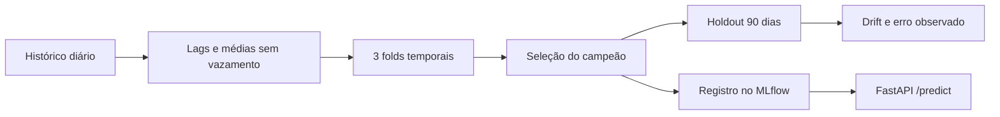
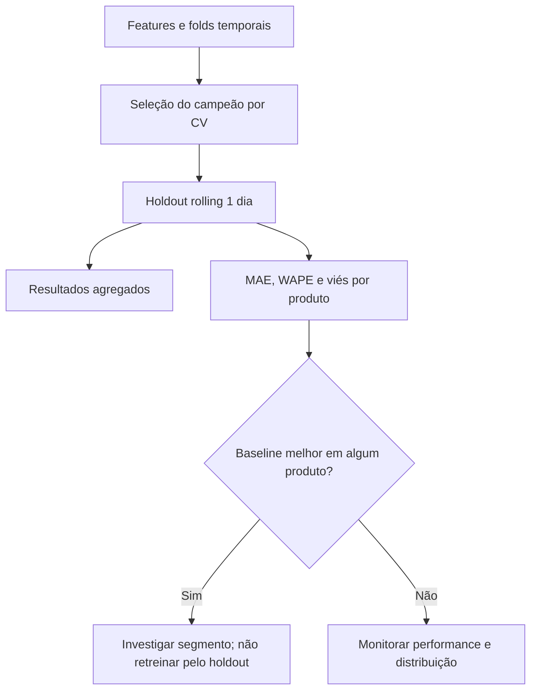
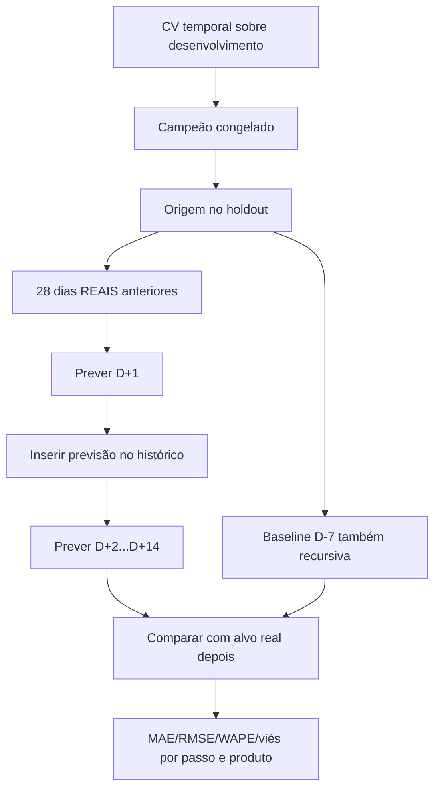
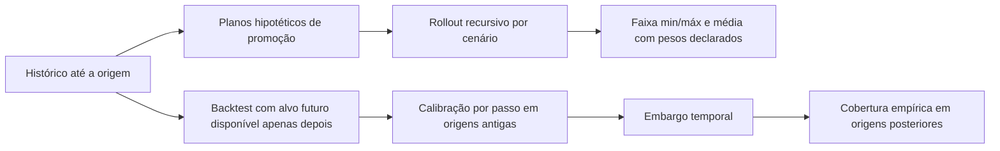

# Previsão de Demanda | Um modelo até a inferência, com MLOps local

**Machine Learning · Séries temporais · scikit-learn · MLflow · FastAPI · Monitoramento**

> **Pergunta:** como prever a demanda diária de produtos, comparar o modelo com um baseline honesto e colocar uma versão rastreável para servir previsões — sem usar informação do futuro?

Este projeto cobre o **ciclo do modelo**: geração/validação dos dados, features temporais, seleção por validação cruzada, holdout, registro de versões, API de inferência e monitoramento. Tudo roda localmente, sem serviço pago.

## Evidência completa — Mac local, 14/10/2026

Executados nesta versão: **29/29 testes aprovados no Mac** (incluindo regressão de datas e depreciações tratadas como erros), treinamento MLflow, backtesting recursivo, calibração por passo e carga real contra Uvicorn no loopback. Condições, saídas e limitações: [`docs/VALIDACAO_MAC_2026-10-14.md`](docs/VALIDACAO_MAC_2026-10-14.md). **A aprovação do GitHub Actions para esta revisão ainda precisa ser confirmada.**

| Estudo | Resultado sintético observado |
| --- | --- |
| Campeão escolhido | `hist_gradient_boosting` (MLflow registry) |
| Holdout de 1 passo | MAE **5,95**, RMSE **7,61**, WAPE **11,34%**; melhoria sobre baseline **55,61%** |
| Backtesting D+1 | MAE **5,24** vs **12,12** (baseline sazonal) |
| Backtesting D+7 | MAE **5,58** vs **12,29** |
| Backtesting D+14 | MAE **6,14** vs **12,62** |
| Inicialização / primeira previsão | **1,46 s** até health / **1,41 s** para primeira inferência |
| Carga com 1 cliente | **8/8 sucessos**, p95 **9,62 ms**, **110,31 req/s** amostrais |
| Carga com 2 clientes | **8/8 sucessos**, p95 **29,31 ms**, **85,45 req/s** amostrais |

**Leitura crítica:** são apenas oito requisições por nível, num único servidor e uma máquina; o p95 é instável e não define capacidade de produção. Na calibração D+1, a cobertura foi **18/18 (100%)**, com 36 observações de calibração e embargo: isso **não** comprova cobertura futura de 90% ou estabilidade para D+14. Promoções planejadas são consideradas conhecidas no backtest; avalie cenários separadamente. O MLflow alertou para desserialização insegura de pickle: carregue somente artefatos próprios/confiáveis.

## O experimento de modelagem

O dataset padrão é **sintético**: seis produtos, 730 dias por produto, com padrões sazonais e promoções simuladas. O modelo prevê **um dia à frente**, assumindo que a demanda real do dia anterior já foi observada.



**Protocolo:** divisão global por data (nenhum produto do mesmo dia fica em treino e validação simultaneamente); três folds *expanding window*, 42 dias por validação; seleção pela MAE média; últimos 90 dias reservados para avaliação. Compara **baseline sazonal D−7, Ridge e HistGradientBoosting**.

### Resultado da execução sintética

| Indicador no holdout de 1 dia | Valor observado |
| --- | ---: |
| Modelo selecionado na validação | **HistGradientBoosting** |
| MAE | **5,95 unidades** |
| RMSE | **7,61 unidades** |
| WAPE | **11,34%** |
| Redução de MAE frente ao baseline sazonal | **55,61%** |

Métricas obtidas no cenário sintético executado em outubro/2026; use `make train` para gerar seus próprios resultados em `work/evaluation/treinamento.json`. **Não extrapole esses números para vendas reais ou previsões recursivas de 7/14 dias**. A faixa empírica decorre de resíduos de validação e não oferece garantia de cobertura.

## Como executar

Requer **Python 3.12**. Na raiz deste repositório:

```bash
python3 -m venv .venv
.venv/bin/python -m pip install -r requirements.txt
make test
make train
make monitor
make smoke
```

O `make test` trata `DeprecationWarning` como erro, para detectar incompatibilidades antecipadamente. O `make smoke` exercita API, promoção e retorno à versão anterior. O primeiro treino cria os artefatos necessários; monitoramento e smoke dependem dele.

### Testar a API

```bash
make api
```

Com esse terminal aberto, em outro terminal na raiz do projeto:

```bash
curl --fail http://127.0.0.1:8000/health
curl --fail -H 'Content-Type: application/json' \
  --data-binary @work/evaluation/exemplo_requisicao.json \
  http://127.0.0.1:8000/predict
```

Documentação interativa: **http://127.0.0.1:8000/docs**. O endpoint `/predict` requer 28 dias consecutivos até D−1; `/forecast` permite inferência recursiva de 1 a 14 dias, **avaliada separadamente por backtesting recursivo na v1.5**.

### Rastreamento e operação

```bash
make mlflow
```

Interface local em **http://127.0.0.1:5000**. `work/mlflow.db` armazena experimentos/registry e `work/deployment.json` define a versão carregada pela API. Uma promoção troca a referência local; o smoke testa restauração. **Os modelos serializados só devem ser carregados de fontes confiáveis.**

Monitoramento em `src/monitor.py` sinaliza distribuições de features (PSI/KS descritivo) e compara erro quando valores reais chegam. Alertas são **convites à investigação**, não retreino automático: sazonalidade e dependência temporal podem produzir falsos positivos.

## Decisões e limites

| Escolha | Por quê |
| --- | --- |
| Features com `shift(1)` | Evitar vazamento da demanda do dia previsto |
| CV temporal + holdout separado | Selecionar modelo sem escolher pelo conjunto de teste |
| Registry local + versão ativa | Rastrear experimentos e permitir rollback |
| API em `127.0.0.1` | Demonstração sem expor um serviço público não autenticado |
| Monitorar antes de retreinar | Reduzir decisões baseadas apenas em alarmes heurísticos |

Código: `src/data.py` (features/splits), `src/train.py` (modelos/MLflow), `src/serve.py` (FastAPI), `src/promote.py` (versões), `src/monitor.py` (drift) e `tests/test_demand.py` (contratos). Detalhes e restrições: [`docs/MODEL_CARD.md`](docs/MODEL_CARD.md).

**CI:** [workflow de inferência e validação](https://github.com/VictorCPena/previsao-demanda-mlops/actions/workflows/ci.yml) (push, pull request ou disparo manual). O projeto não é um sistema de previsão em produção, não tem autenticação pública nem operação em nuvem; os estudos de carga e backtesting da v1.5 são locais e experimentais.

## Diagnóstico pós-holdout por produto (v1.4)

Uma média global boa pode esconder um produto ruim. O módulo [`src/evaluate.py`](src/evaluate.py) introduz uma leitura **por produto**, sem mexer na escolha do campeão:



| Métrica nova | Pergunta que responde | Limitação |
| --- | --- | --- |
| MAE por produto | Qual SKU tem maior erro médio absoluto? | Escala varia por SKU |
| WAPE por produto | Erro em relação ao volume vendido | Indefinido quando soma real = 0 (`null`) |
| Viés por produto | Há tendência de super ou subprever? | Um sinal persistente requer mais janelas |
| Baseline vence | Em quais SKUs a complexidade perde do D−7? | Pós-hoc; não escolher novo campeão no teste |

```bash
make train
make evaluate
cat work/evaluation/avaliacao_por_produto.json
```

**Protocolo:** o módulo consome `previsoes_holdout.csv` depois do treino; não usa esse arquivo para selecionar hiperparâmetros. Rejeita chaves `(produto, dia)` duplicadas, valores negativos, infinitos e faltantes. Veja [`docs/AVALIACAO_E_OPERACAO.md`](docs/AVALIACAO_E_OPERACAO.md).

### Checklist de operação responsável

- A aplicação roda em `127.0.0.1`; **não** é uma API pública autenticada.
- Antes de inferir, confirmar `model_ready` e a versão ativa do registry; bundles são desserializados apenas de origem confiável.
- Monitorar drift como **sinal investigativo**: PSI, KS e sazonalidade não autorizam retreino automático.
- Uma MAE medida com a demanda real de D−1 disponível **não** comprova a mesma acurácia para previsão recursiva de 7 ou 14 dias.

**Etapa implementada na v1.5:** backtest recursivo com cortes sucessivos, métricas por horizonte e comparação aos mesmos baselines; a v1.6 acrescenta cenários de promoções e calibração por passo. A próxima investigação é generalização entre SKUs e sazonalidades.

---

## v1.5: backtesting recursivo multihorizonte — uma avaliação diferente

O holdout de 1 dia informado acima responde *“qual o erro com D−1 real disponível?”*. Ele **não** responde *“qual o erro acumulado durante 7 ou 14 dias sem observar a demanda intermediária?”*. Agora o projeto mede ambas as situações, sem usar o futuro nas features.



**Protocolo:** origens deslizantes a cada sete dias nos últimos 90 dias; cenários com horizontes **1, 7 e 14**, usando promoções **planejadas e conhecidas**. O modelo campeão é selecionado e treinado antes do holdout; entre duas origens os dados reais anteriores tornam-se observáveis, mas **dentro de uma previsão** todos os passos futuros usam as previsões anteriores. O horizonte de 14 dias também testa deriva no baseline sazonal recursivo.

```bash
make train
make evaluate       # rolling de 1 dia, análise por produto
make backtest       # avaliação recursiva rolling-origin 1/7/14
```

Saídas locais: `work/evaluation/backtest_recursivo.json` (resumo por passo, horizonte e produto) e `backtest_recursivo_linhas.csv` (cada origem e previsão para auditoria). As métricas são calculadas **após** a previsão; a frequência de origens pode sobrepor janelas e não deve ser usada para IC com independência ingênua. A faixa empírica do endpoint de 1 dia **não é calibrada para 14 dias**. Veja [`docs/BACKTEST_E_PERFORMANCE.md`](docs/BACKTEST_E_PERFORMANCE.md).

### Cold start e estudo de carga da API

`src/load_study.py` sobe **um servidor novo em loopback**, espera a prontidão, mede a **primeira inferência** e depois mede requisições de aquecimento e lotes de carga com **1, 4 e 8 clientes simultâneos**.

```bash
make load-study
```

O experimento salva `work/evaluation/load_study.json` com **tempo até saúde, primeira previsão, p50/p95/p99, taxa de erro e throughput** por nível. O script se limita a 16 clientes e 500 requisições por nível e **não envia carga a sites externos**. A API agora mantém um cache local da versão ativa (invalidado por caminho/mtime/tamanho), reduzindo o custo de desserialização recorrente e respeitando a troca de modelo para rollback.

> **Atenção:** latências medidas no seu Mac não equivalem a SLO de nuvem. Inicialização de processo, desserialização do modelo e inferência são fases diferentes. Uma amostra pequena não sustenta um p99 de produção. O estudo depende de `make train` e do `exemplo_requisicao.json` gerado no treinamento.

A automação de CI executa o backtest e um **smoke de carga curto** após o treino; o benchmark completo é manual para evitar medições ruidosas e custo de runner. Os novos testes verificam *leakage*, equivalência treino/serviço, cache e rollback, cenários inválidos e métricas por horizonte.

### Evidências de verificação local

Em um ensaio independente com o HistGradientBoosting ajustado na janela de desenvolvimento, o **MAE em D+1/D+7/D+14 foi 5,31 / 5,58 / 6,05**, frente a **12,12 / 12,29 / 12,62** da baseline sazonal recursiva (66 pares origem-produto por passo). Isso é uma **checagem sintética do algoritmo**, não substitui a seleção CV/MLflow do fluxo oficial. Consulte [`docs/VALIDACAO_LOCAL_V15.md`](docs/VALIDACAO_LOCAL_V15.md) para protocolo e distinções.

---

## v1.6 — promoções incertas, calibração por horizonte e execução multiworker

A versão anterior avaliava recursão assumindo promoções futuras conhecidas. Agora separamos explicitamente **incerteza de cenário** (promoção pode ocorrer ou não) de **erro de previsão dentro de um cenário**.



- **`POST /forecast/scenarios`**: `horizon=1..14`, histórico de 28+ dias e até 8 cenários explícitos com pesos que somam 1; usa três cenários ilustrativos quando não informados. Não precisa conhecer as promoções que realmente ocorrerão.
- **`make calibrate`**: após `make train && make backtest`, estima quantil de erro absoluto por passo D+1..D+14 num bloco temporal anterior e mede cobertura posterior com embargo de 14 dias. O método retorna erro explícito com amostra insuficiente e **não afirma cobertura formal sob dependência temporal**.
- **`make container`**: Docker Compose local, Python 3.12, 2 workers Uvicorn, usuário não-root, volume de modelos em read-only, filesystem read-only e porta apenas no loopback. Exige Docker instalado no computador; não faz deploy automático em nuvem.

**Conceitos diferentes:** a faixa min/max dos cenários **não** é IC de 90%. Os quantis empíricos não capturam automaticamente a incerteza de promoções não observadas, e o container multiworker **não** é autoscaling distribuído. Veja [desenho do estudo e operações](docs/CENARIOS_INTERVALOS_E_DEPLOY.md).
