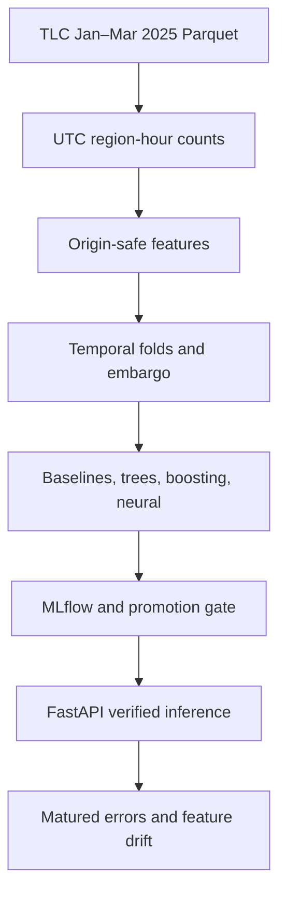

# Real-World Forecasting & Production MLOps

Forecast hourly New York City green taxi demand using temporal backtesting, an MLflow registry and a FastAPI service.

**Local evidence.** The API forecast 5.87 trips for zone 74 one hour ahead. The held-out observation was 2 trips. [Run record](evidence/mac-forecast-replay-20261109/result.json).

Based on [previsao-demanda-mlops](https://github.com/VictorCPena/previsao-demanda-mlops/tree/8c132ff533c6877519838a8204fa88cfe8eebfa3).

## 1. Problem Statement

Forecast published NYC green-taxi pickup counts by region at direct horizons of 1, 6 and 24 hours. Demonstrate origin-safe features, temporal selection, model lifecycle and measured inference behavior. Existing synthetic product-demand forecasting APIs/backtests and their tests are preserved under `src/`.

## 2. Architecture



The real-data API is `forecasting.api`; the original API is `src/serve.py`. These use different contracts and work directories.

## 3. Tech Stack

Python, Pandas/Parquet, scikit-learn, PyTorch CPU, MLflow SQLite tracking/registry, FastAPI, pytest and Dockerfiles. Feast was omitted because a local, versioned batch feature contract suffices for this scale. No distributed serving claim is made. Native Spark is demonstrated by the separate lakehouse project; this small TLC workload uses Pandas.

## 4. Dataset & Data Provenance

[NYC TLC Trip Record Data](https://www.nyc.gov/site/tlc/about/tlc-trip-record-data.page), green taxi Jan–Mar 2025. Full monthly files are ingested. The top three pickup zones are selected using **only the first 14 days**, before model validation. Hourly timestamps are localized from New York wall time to UTC; nonexistent/ambiguous times are rejected. UTC prevents a duplicate/missing daylight-saving hour from silently corrupting lags. Source digests and rejected counts are in `data/tlc_hourly.json`. Published pickups measure served demand, not unmet demand; source reporting gaps may resemble zero demand. TLC publishes data supplied by providers without guaranteeing accuracy; NYC use terms apply.

## 5. Setup & Installation

Original full PyTorch profile: Linux x86_64 with Python 3.12. Intel macOS uses a separate native scikit-learn MLP profile. The portable profile was tested on Linux with Python 3.12 by setting `FORECAST_NEURAL_BACKEND=sklearn`. A separate macOS API replay is reported below. From this repository directory:

```bash
bash scripts/setup.sh
source .venv/bin/activate
```

Direct dependencies are pinned in `requirements-portfolio.txt`. `requirements-lock.txt` records the tested Linux dependency closure. CPU PyTorch is installed first on Linux. The Intel Mac installer excludes PyTorch and selects a clearly named sklearn_mlp candidate with two hidden layers (32, 16), training-only feature/target scaling and no random early-stopping validation. Existing TorchMLP remains unchanged. Set FORECAST_NEURAL_BACKEND=torch or sklearn to choose explicitly; auto selects sklearn only on Intel macOS. The two backends use different optimization recipes and are not numerically interchangeable. Large data and model weights are fetched from their public providers; first execution requires internet access. No paid API key or cloud billing is required.

## 6. Running Locally

```bash
python -m forecasting.demo --download
python -m uvicorn forecasting.api:app --host 127.0.0.1 --port 8000
```

Open [the API docs](http://127.0.0.1:8000/docs). The first request to `/health` loads and verifies the active model. Use a longer timeout for that initial request on slower machines. In a second terminal, run `python scripts/load_api.py --module forecasting.api:app` from this repository after training for a bounded local HTTP check.

Use `--raw-dir PATH` for the three existing `green_2025-MM.parquet` files. Training writes `work/tlc`, MLflow registry state, model bundles, holdout predictions and a deployment manifest. API `/docs` exposes the strict history contract. Requests supply a trained zone, supported horizon and at least 192 observed contiguous hourly UTC records ending at the forecast origin. No future placeholder value can enter that horizon's features. `/metrics` exports safe operational counters.

## 7. Testing

```bash
python -m pytest -q
python -m ruff check forecasting tests/test_pro_forecast.py scripts/load_api.py
python scripts/load_api.py --module forecasting.api:app
```

Tests mutate observations after forecast origins to detect leakage for all three horizons; reject duplicate/gapped history, unsupported regions and negative demand; verify model digests; test promotion/rollback, drift and neural serialization. Original tests remain intact. The HTTP study performs actual localhost requests, not an in-memory substitute.

## 8. Performance Results

Holdout MAE (trips/hour/zone), with selection performed by temporal CV before this holdout:

| model             |     1 |      6 |    24 |
|:------------------|------:|-------:|------:|
| gradient_boosting | 2.284 |  2.548 | 2.556 |
| moving_average    | 7.519 |  7.637 | 7.911 |
| persistence       | 3.769 | 10.702 | 4.084 |
| random_forest     | 2.285 |  2.641 | 2.424 |
| ridge             | 2.581 |  2.888 | 2.668 |
| seasonal_naive    | 2.730 |  2.730 | 2.730 |
| torch_mlp         | 2.413 |  2.586 | 2.555 |

The [zone 74 holdout chart](evidence/holdout_zone74.png) shows one region's forecast versus observed demand. Winners: 1h gradient boosting, 6h gradient boosting, 24h random forest. Deep learning was compared and was not assumed to win. `work/tlc/training.json` and `evidence` include WAPE/RMSE, region/horizon errors, empirical interval coverage, run IDs, latency and monitoring. Seventy-two HTTP requests across concurrency 1/4/8 completed without errors in the recorded bounded study and a subsequent restart recovered service. This is not a production capacity or availability certification.

Portable-profile evidence (executed on Linux, **not a Mac benchmark**): 40 tests passed and one exclusive PyTorch test was skipped because this profile does not install PyTorch. The scikit-learn MLP holdout MAE was 2.376 / 2.536 / 2.543 at 1 / 6 / 24 hours. Temporal CV selected gradient boosting / sklearn_mlp / random forest respectively. See `evidence/mac_profile_training.json`; these do not overwrite the original PyTorch-study evidence. A separate bounded HTTP study completed 72 requests with zero errors and a successful process restart (`evidence/mac_profile_http_load.json`). The naming denotes the intended compatibility profile, not the machine used for this measurement.

macOS API replay reported by the user on 2026-11-09. The 1-hour gradient boosting model forecast 5.866 trips for zone 74 at 03:00 UTC on April 1, 2025. The reserved observation was 2 trips, an absolute error of 3.866. The prediction, empirical band [0, 12.344], observed value and dataset fingerprint match the archived holdout evidence. See `evidence/mac-forecast-replay-20261109/result.json` for the exact values and cross-check.

To reproduce that profile on Linux without installing PyTorch, install the requirements with the torch line excluded into a separate environment and set `FORECAST_NEURAL_BACKEND=sklearn`. The normal Linux setup intentionally retains PyTorch. A single deprecation warning from FastAPI/Starlette's httpx test client remains documented; request assertions passed.

## 9. Engineering Decisions

Direct horizon-specific models avoid feeding real future demand into multi-step evaluation. For target t and horizon h, all demand features are available at or before t-h. Temporal training labels are embargoed by horizon. Calendar features are known in advance. Standardization is fitted on training rows only. CV selects the champion; holdout reports final performance. Prediction bands are empirical CV absolute-residual bands, not a nominal coverage guarantee under serial dependence. Model files are fingerprinted; serving loads only project-generated trusted artifacts.

## 10. Failure Handling

`forecasting.operations.deploy` rejects a candidate with missing artifacts or validation regression; atomic manifest replacement preserves a previous version for rollback. The API fails closed on absent/corrupt model files. Monitoring compares matured errors and feature KS distances, and triggers review rather than silently retraining/promoting. A deployment writer is expected to be single-process; multi-writer registry updates are not yet certified. New training execution versions models in MLflow; it does not rewrite a deployed model in place.

## 11. Limitations

Three zones and one calendar quarter cannot establish annual seasonality, broad geographic generalization or holiday robustness. Aggregation is hourly; alternate aggregation forecasting accuracy has not been compared. No live TLC data freshness monitor, unattended retraining scheduler, Evidently deployment or cloud inference endpoint has been validated. Source hashes and model recipes support reproducibility; binary model artifacts remain environment-version-dependent. No paid service was used.

Serve trusted artifacts created by the documented training pipeline. The example binds the API to localhost.

## 12. Future Improvements

More months and regions; full multi-season evaluation; independent conformal calibration with dependence-aware coverage checks; explicit reporting-lag ingestion windows; guarded retraining job; serving stress/saturation study; alternate interval aggregation experiments.

The [original synthetic workflow guide](docs/README_ORIGINAL.md) remains available.
