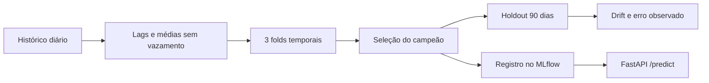

# Previsão de Demanda | Um modelo até a inferência, com MLOps local

**Machine Learning · Séries temporais · scikit-learn · MLflow · FastAPI · Monitoramento**

> **Pergunta:** como prever a demanda diária de produtos, comparar o modelo com um baseline honesto e colocar uma versão rastreável para servir previsões — sem usar informação do futuro?

Este projeto cobre o **ciclo do modelo**: geração/validação dos dados, features temporais, seleção por validação cruzada, holdout, registro de versões, API de inferência e monitoramento. Tudo roda localmente, sem serviço pago.

## O experimento de modelagem

O dataset padrão é **sintético**: seis produtos, 730 dias por produto, com padrões sazonais e promoções simuladas. O modelo prevê **um dia à frente**, assumindo que a demanda real do dia anterior já foi observada.



**Protocolo:** divisão global por data (nenhum produto do mesmo dia fica em treino e validação simultaneamente); três folds *expanding window*, 42 dias por validação; seleção pela MAE média; últimos 90 dias reservados para avaliação. Compara **baseline sazonal D−7, Ridge e HistGradientBoosting**.

### Resultado da execução sintética

| Indicador no holdout de 1 dia | Valor observado |
| --- | ---: |
| Modelo selecionado na validação | **HistGradientBoosting** |
| MAE | **5,95 unidades** |
| RMSE | **7,61 unidades** |
| WAPE | **11,34%** |
| Redução de MAE frente ao baseline sazonal | **55,61%** |

Métricas obtidas no cenário sintético executado em outubro/2026; use `make train` para gerar seus próprios resultados em `work/evaluation/treinamento.json`. **Não extrapole esses números para vendas reais ou previsões recursivas de 7/14 dias**. A faixa empírica decorre de resíduos de validação e não oferece garantia de cobertura.

## Como executar

Requer **Python 3.12**. Na raiz deste repositório:

```bash
python3 -m venv .venv
.venv/bin/python -m pip install -r requirements.txt
make test
make train
make monitor
make smoke
```

O `make test` trata `DeprecationWarning` como erro, para detectar incompatibilidades antecipadamente. O `make smoke` exercita API, promoção e retorno à versão anterior. O primeiro treino cria os artefatos necessários; monitoramento e smoke dependem dele.

### Testar a API

```bash
make api
```

Com esse terminal aberto, em outro terminal na raiz do projeto:

```bash
curl --fail http://127.0.0.1:8000/health
curl --fail -H 'Content-Type: application/json' \
  --data-binary @work/evaluation/exemplo_requisicao.json \
  http://127.0.0.1:8000/predict
```

Documentação interativa: **http://127.0.0.1:8000/docs**. O endpoint `/predict` requer 28 dias consecutivos até D−1; `/forecast` permite inferência recursiva de 1 a 14 dias, **ainda não validada empiricamente por horizonte**.

### Rastreamento e operação

```bash
make mlflow
```

Interface local em **http://127.0.0.1:5000**. `work/mlflow.db` armazena experimentos/registry e `work/deployment.json` define a versão carregada pela API. Uma promoção troca a referência local; o smoke testa restauração. **Os modelos serializados só devem ser carregados de fontes confiáveis.**

Monitoramento em `src/monitor.py` sinaliza distribuições de features (PSI/KS descritivo) e compara erro quando valores reais chegam. Alertas são **convites à investigação**, não retreino automático: sazonalidade e dependência temporal podem produzir falsos positivos.

## Decisões e limites

| Escolha | Por quê |
| --- | --- |
| Features com `shift(1)` | Evitar vazamento da demanda do dia previsto |
| CV temporal + holdout separado | Selecionar modelo sem escolher pelo conjunto de teste |
| Registry local + versão ativa | Rastrear experimentos e permitir rollback |
| API em `127.0.0.1` | Demonstração sem expor um serviço público não autenticado |
| Monitorar antes de retreinar | Reduzir decisões baseadas apenas em alarmes heurísticos |

Código: `src/data.py` (features/splits), `src/train.py` (modelos/MLflow), `src/serve.py` (FastAPI), `src/promote.py` (versões), `src/monitor.py` (drift) e `tests/test_demand.py` (contratos). Detalhes e restrições: [`docs/MODEL_CARD.md`](docs/MODEL_CARD.md).

**CI:** [workflow de inferência e validação](https://github.com/VictorCPena/previsao-demanda-mlops/actions/workflows/ci.yml) (manual). O projeto não é um sistema de previsão em produção, não tem autenticação pública, nem estudo de carga, cold start ou backtesting recursivo multihorizonte.
