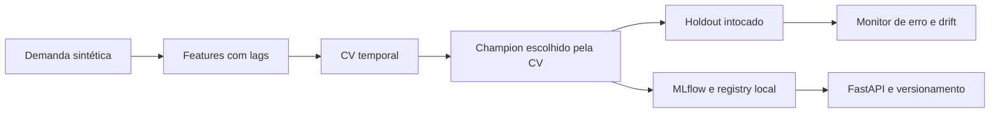

# Arquitetura e evidências

**Escolhas:** todos os produtos do mesmo dia permanecem juntos nos folds; nenhum alvo futuro
entra nas features; champion escolhido sem usar holdout; API valida histórico, lags e produto.
**Limite:** avaliação de um dia; sem validação de horizonte recursivo >1 dia, sem operação 24/7.
**Evidências:** JSON de treino, monitoramento, smoke de API/MLflow e CI.
